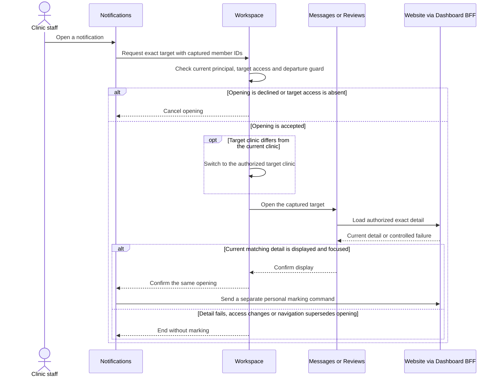

# Notification frontend contract

See [Frontend Architecture](./frontend-architecture.md) for shared rules. The
[approved compact feed and state mockups](../plans/assets/clinic-notification-center/README.md)
record the original visual direction. Current visual tokens and component states belong to the [design system](../../DESIGN.md).

## Notification foundation

The `notifications` domain owns its serializable `clinic-notifications-v1` models, browser commands, controller, panel and private provider. Central composition selects Controlled or Payload reads and personal marking using the verified session and personal principal independently of the active clinic. Its separate central composition entry receives the current authorized clinic IDs only for the synthetic Controlled source; the Website source derives its own current actor and authorization. The local cross-app lane uses Payload notifications while unrelated presentation sources remain Controlled.

Every presentation entry carries the stable source clinic ID and current clinic name. Website applies current authorization and expiry before grouping by clinic and inquiry, sorting, pagination and counting. Signed feed cursors bind to principal, view and version independently of the active clinic.

GET `/api/notifications` accepts only a summary or a selected Unread/All page request. It preserves private response headers and session-cookie updates. Website authorizes the individual catalogue members. The BFF does not gate the full catalogue on inquiry permission. Payload and browser transports reject unknown shapes, request/response mismatches, expired entries and oversized bodies. Initial pages carry complete count fields; continuations carry neither. Independent Website-owned examples are exercised through BFF and provider tests.

POST `/api/notifications/read` accepts only the complete `notificationIds` selection. It validates exact origin, CSRF and session, then enforces the 4 MiB UTF-8 body limit before calling the Website command. It sends one atomic request regardless of member count. The Website derives the reader and timestamp, rechecks current access and expiry, and preserves each first personal receipt. Controlled providers retain synthetic receipts by principal across clinic switching, session token rotation and request composition and expose a test reset.

The entry menu fixes its complete member IDs when marking starts. Confirmed marking requests a current feed and complete count. A failed following refresh preserves confirmed marking and labels retained data as outdated. Proven non-commit and unknown submitted-write outcomes have separate feedback. Checking status repeats a read; manually repeating a write retains the original IDs and honors Retry-After. Writes never retry automatically. The shared dropdown accepts a local portal container so row menus remain inside the mobile modal dialog.

The shared clinic layout owns the notification controller across clinic-page remounts. A principal or clinic change
clears the current feed and count, cancels old reads, and invalidates outstanding marking results before reloading
the authorized personal feed. Feed cursors and receipts are personal.

An accepted exact opening can survive the clinic change to its captured, currently authorized destination for the
same principal and navigation generation. The notification controller freezes the entry's member IDs. Workspace
uses the shared inquiry, review, and profile editor departure guard before navigating. A declined guard, principal change, loss of target
access, unrelated navigation, or replacement opening cancels the pending completion.
[Exact clinic navigation browser cases](../../tests/e2e/exact-clinic-navigation.spec.ts)

Messages and Reviews load the ordinary authorized exact detail, independently of list filters and pagination.
Reopening the same inquiry performs another authorized read. Review detail and its current workflow reads share
an eight-second deadline. Optional anchors use the loaded timeline or response and appeal record IDs, with an
exact-detail heading fallback. Only the matching current detail after DOM commit and semantic focus confirms
display. Notifications then sends its separate personal marking command with the original selection.
Reads and failed or superseded openings create no receipt. Marking uncertainty leaves the displayed detail open.

A fresh authorized review detail can reveal a redaction, withdrawal, or removal after the list was loaded. It replaces
the matching card, and older list responses cannot restore hidden content. A confirmed `not-found` removes the card.
A transient detail failure leaves the list intact. A loss of review access clears the review list and closes the
dialog. Refresh the ordinary authorized list to update affected counts and pagination.
[Review visibility decision](https://github.com/findmydoc-platform/clinic-dashboard/pull/215#points-to-review)

### Opening a notification across clinics

### Feed refresh and expiry

Each visible, online authenticated tab starts an independent notification read every 30 seconds. A closed center reads the full summary; an open center reloads its selected view through the previously loaded oldest item within one eight-second cycle. The controller publishes the replacement only after all requested pages succeed. It keeps the current view and scroll position while updating, coalesces overlapping triggers, and drops superseded generations and pagination responses. Opening, switching views, visibility and connectivity recovery, and confirmed personal marking request an immediate read. Transient failures retain visibly stale, unexpired permitted rows and retry after 5, 10, 20, then 30 seconds, subject to a longer Retry-After. Authorization loss clears the affected rows and count; incompatible responses stop automatic reads. A failed read after confirmed marking preserves that confirmed outcome. No read failure retries a write.

The browser hides each loaded member at its individual `expiresAt`, updates message-group membership and ordering, and requests a complete count at `nextUnreadCountChangeAt`. It hides a count whose deadline has passed until a successful authoritative read supplies a current count. Long waits use browser-safe timer chunks while preserving the absolute expiry. These client timers complement Website authorization and expiry enforcement; a browser refresh cannot extend retention or restore inaccessible content. The notification BFF logs a classified, identifier-free read failure and duration even when its upstream transport fails; Website records successful and failed source reads in its existing structured diagnostics.
