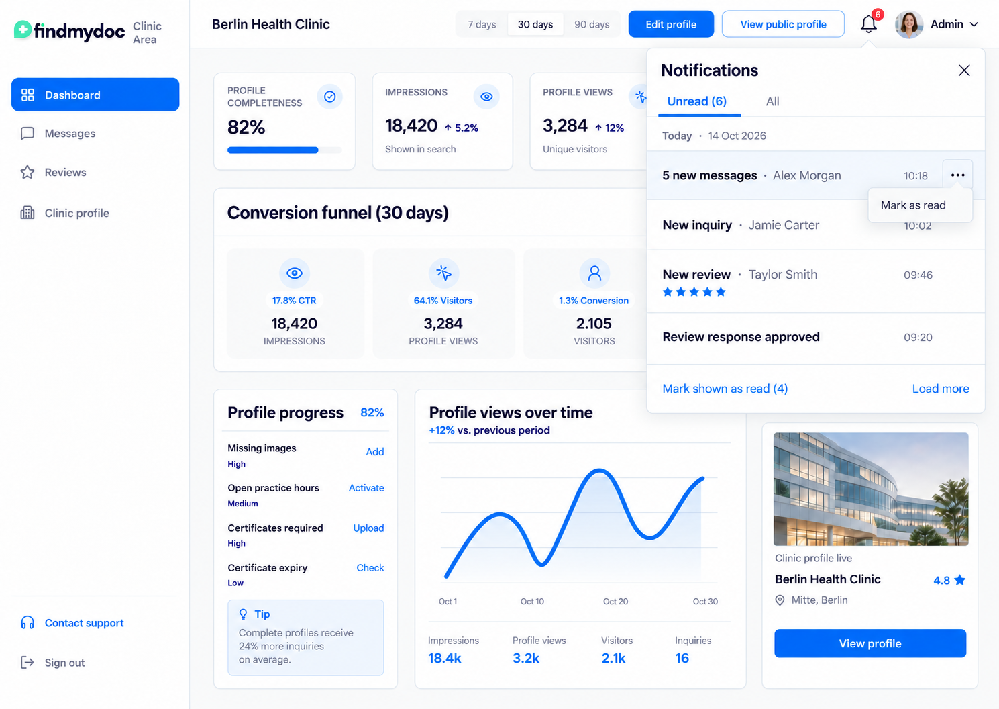
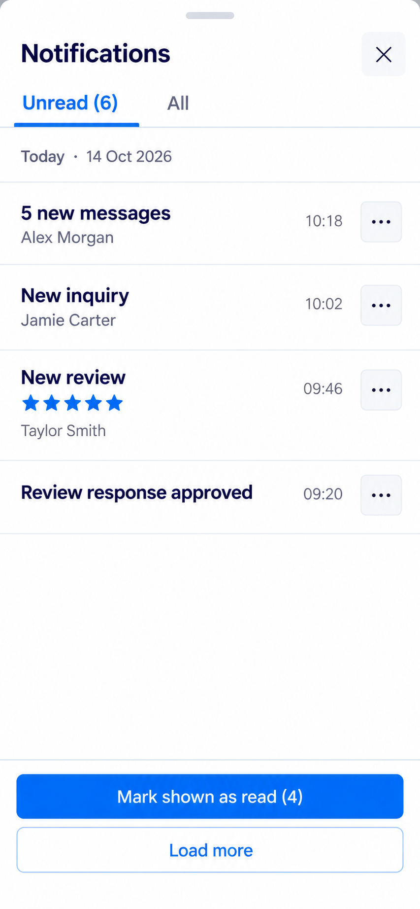
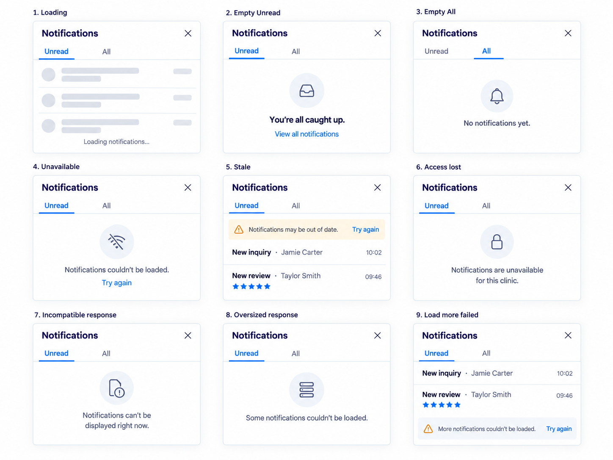
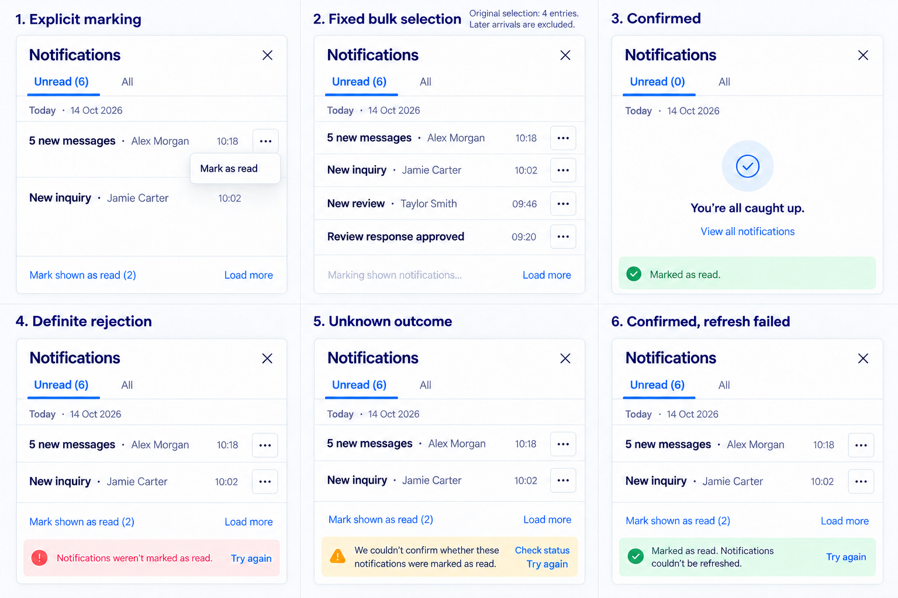
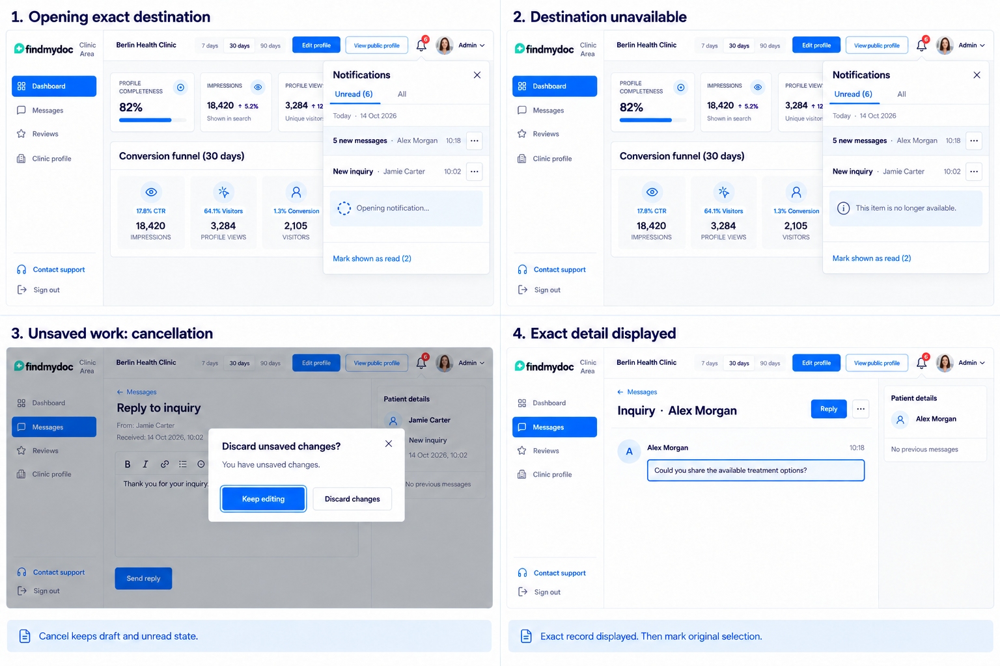

# Notification center reference assets

[Issue #201](https://github.com/findmydoc-platform/clinic-dashboard/issues/201) extends the approved compact feed.
The [notification frontend contract](../../../engineering/notification-frontend-contract.md) describes current
behavior. [PR #215](https://github.com/findmydoc-platform/clinic-dashboard/pull/215) delivered the center and its
[pinned design mapping](https://github.com/findmydoc-platform/clinic-dashboard/blob/90f234c0e0172053feb9713c4f67ba078927a3af/docs/plans/notification-center-design.md).

[The selected original](notification-feed-selected.png) is the visual reference. The state mockups below contain
synthetic data. [Generation prompts](v1/prompts.json) record inputs and dimensions. Use the
[design system](../../../../DESIGN.md) for current tokens and browser tests for interaction and accessibility evidence.

## Desktop Unread

Six complete unread entries, four shown, and five message-group members. The menu documents personal explicit marking.

## Desktop All

Two displayed unread entries. The unread message group remains complete; read patient messages have separate rows.

## Mobile

The full-width drawer retains close, tabs and reachable footer actions. The central region scrolls independently during implementation.

## Read states

Loading, empty Unread, empty All, unavailable reads, stale reads, access loss, incompatibility, oversized responses and failed Load more retain their distinct meaning.

## Marking states

Explicit marking and bulk marking keep the fixed original selection. Definite rejection, uncertain write outcome and confirmed marking with failed refresh receive different feedback.

## Destination states

Opening, unavailable content, cancelled unsaved-work navigation and actual exact detail display precede any automatic marking.

