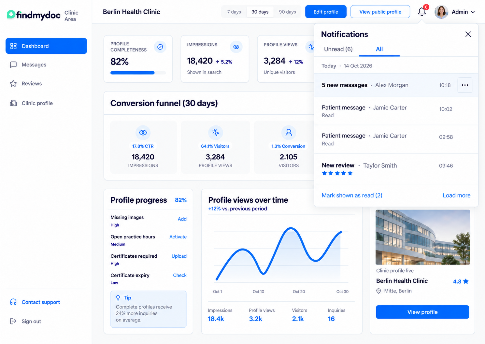
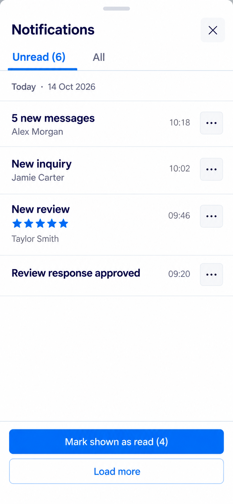
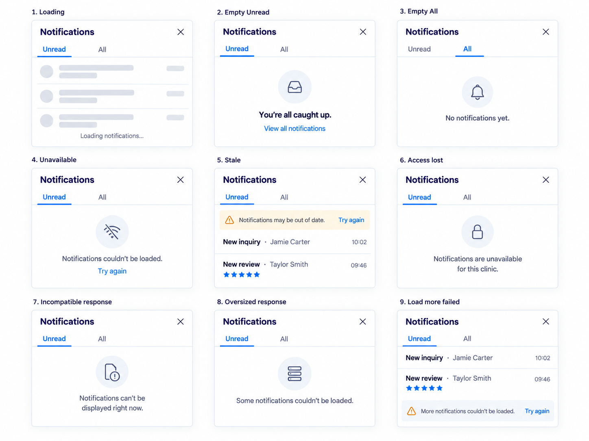
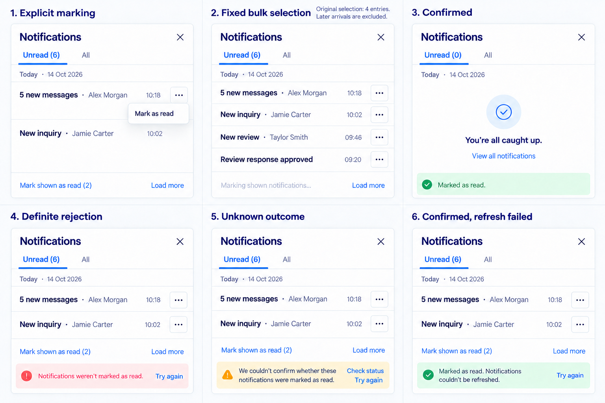
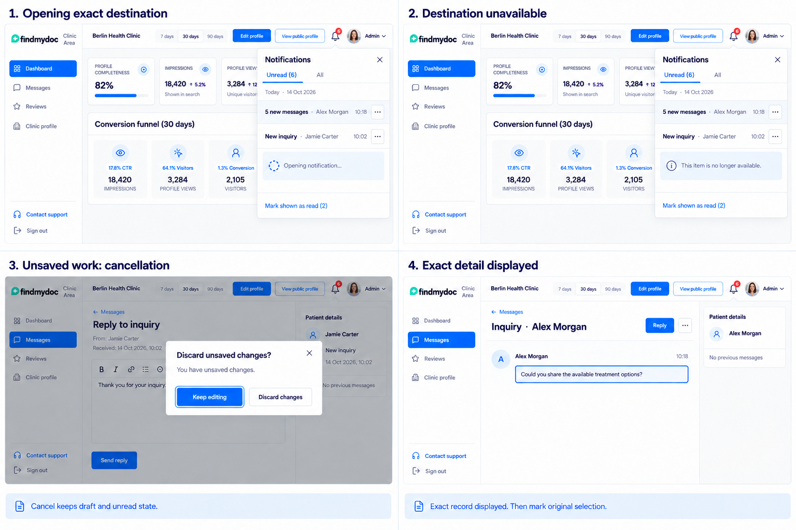

# Notification center reference assets

Version 1, 2026-10-14. [#201](https://github.com/findmydoc-platform/clinic-dashboard/issues/201) extends the approved compact feed, candidate 1. The [design mapping](../../notification-center-design.md) specifies behavior, copy, count semantics, accessibility requirements and the applicable later tickets.

`notification-feed-selected.png` is the unchanged approved original, pinned at commit `d6b8e8b1dd197576a4470d31899577fde81747ad`. The six additional PNGs are supporting state references from built-in Image Gen. Every generation received the original image as input and the existing design-system constraints. [prompts.json](v1/prompts.json) records the complete prompts, requested dimensions and input roles.

These are static mockups, not implemented UI or accessibility evidence. All content is synthetic. State-board panels are independent snapshots, not a sequential transaction timeline. Use the written mapping when generated text, tokens or icons differ. Preserve essential contrast, current selected-state tokens and the canonical brand/icon components during implementation. Keep the original and version 1 files available when adding a later reference version.

## Desktop Unread

Six complete unread entries, four shown, and five message-group members. The menu documents personal explicit marking.

## Desktop All

Two displayed unread entries. The unread message group remains complete; read patient messages have separate rows.

## Mobile

The full-width drawer retains close, tabs and reachable footer actions. The central region scrolls independently during implementation.

## Read states

Loading, empty Unread, empty All, unavailable reads, stale reads, access loss, incompatibility, oversized responses and failed Load more retain their distinct meaning.

## Marking states

Explicit marking and bulk marking keep the fixed original selection. Definite rejection, uncertain write outcome and confirmed marking with failed refresh receive different feedback.

## Destination states

Opening, unavailable content, cancelled unsaved-work navigation and actual exact detail display precede any automatic marking.

