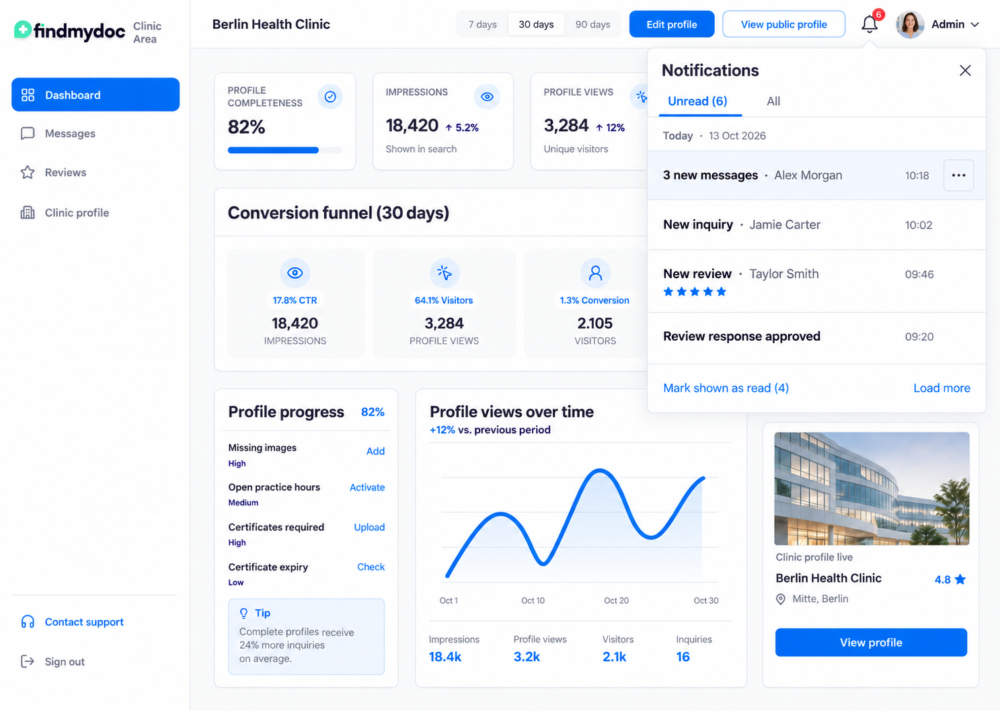

# Notification center design references

Version 1, 2026-10-14. This document provides the local design artifacts for [#201](https://github.com/findmydoc-platform/clinic-dashboard/issues/201) against [#200](https://github.com/findmydoc-platform/clinic-dashboard/issues/200). It preserves approved candidate 1. The additional images extend its states; they are not alternative design proposals. Publication and the ticket's image-preview links remain pending until the artifacts can be pushed.

The current Dashboard uses demo notifications and session-local read IDs. These references describe the authorized notification center that later tickets implement. They do not establish backend availability, interaction correctness, WCAG compliance, or Preview/Production activation.

## Visual target and reference index

The [pinned selected original](https://github.com/findmydoc-platform/clinic-dashboard/blob/d6b8e8b1dd197576a4470d31899577fde81747ad/docs/plans/assets/clinic-notification-center/notification-feed-selected.png) remains the layout authority. The repository copy is unchanged. Use compact event-first rows, quiet secondary metadata, DM Sans, the existing brand, English copy, and lightweight separators. Use current `DESIGN.md` tokens for selected controls and navigation, including restrained accent treatment. The mockups preserve the original's blue tab underline as an illustrative cue, not a token override. Keep unrelated Dashboard chrome governed by `DESIGN.md`; illustrative numbers and unrelated dashboard content in the original are not implementation requirements.

| Reference                                                                         | Purpose                                                                                                                | Implementation tickets       |
| --------------------------------------------------------------------------------- | ---------------------------------------------------------------------------------------------------------------------- | ---------------------------- |
| [Desktop Unread](assets/clinic-notification-center/v1/desktop-unread.png)         | Compact rows, explicit marking menu, full bell count, group membership count, displayed-entry bulk count, pagination   | #202, #203, #212, #214       |
| [Desktop All](assets/clinic-notification-center/v1/desktop-all.png)               | Same layout with quiet read entries, unread groups and individually read patient messages                              | #203, #204, #205, #206, #207 |
| [Mobile](assets/clinic-notification-center/v1/mobile-unread.png)                  | Full-width modal drawer, visible close, readable rows, scrolling and fixed controls                                    | #202, #203, #207, #212, #214 |
| [Read states](assets/clinic-notification-center/v1/read-states.png)               | Loading, empty views, stale/unavailable reads, access loss, unsupported response, size failure and failed continuation | #202, #207, #208             |
| [Marking states](assets/clinic-notification-center/v1/marking-states.png)         | Explicit marking, fixed bulk selection, rejection, uncertain outcome, confirmed marking with failed refresh            | #212, #214, #208             |
| [Destination states](assets/clinic-notification-center/v1/destination-states.png) | Exact navigation, unavailable content, unsaved-work cancellation and successful display before marking                 | #213, #204, #205, #206       |

These paths are versioned design artifacts, not screenshots of working UI. Image Gen can approximate text and icons. The written behavior and copy below govern implementation wherever a generated image differs. The unsaved-work modal illustrates cancellation; retain each owning editor's existing confirmation copy and actions. Use the canonical `BrandMark` and existing icon components in the application, not pixels from these mockups.

## Counts, rows and actions

The desktop Unread example has six unread entries across the complete authorized history, four currently shown. One of the four is a group containing five unread patient messages. Its row says "5 new messages"; it contributes one to the bell and one to "Mark shown as read (4)". The other two unread entries are unloaded. These counts must not be used interchangeably.

The All example retains the same panel, tabs, date headings and row geometry. Its unread patient-message group remains one entry. Read patient messages appear separately, with one timestamp per occurrence. Read entries use normal rather than bold event labels and quieter decoration; their essential text remains legible. Preserve occurrence ordering and use the newest eligible member to position a group. Do not group historical read messages or reorder by urgency.

| Control or information      | Behavior                                                                                                                                                                                                                                   |
| --------------------------- | ------------------------------------------------------------------------------------------------------------------------------------------------------------------------------------------------------------------------------------------ |
| Bell badge and `Unread (6)` | Complete authorized, unexpired personal unread-entry count, including unloaded entries. A group counts once. An unavailable count shows an explicit updating/unavailable state, never a fabricated zero.                                   |
| Event row                   | Opens the exact authorized inquiry or review. Show permitted event label, display name, time, and optional rating/outcome. Do not show message bodies, attachments or internal moderation reasons. Missing display information is omitted. |
| `5 new messages`            | Complete current group membership, never a loaded-message subset. An action carries all represented member IDs.                                                                                                                            |
| Row menu `Mark as read`     | Explicit personal marking without opening a destination. Already-read All rows do not offer an unread-marking action.                                                                                                                      |
| `Mark shown as read (4)`    | Captures every currently displayed unread entry's complete membership when pressed. Excludes unloaded entries, read rows and messages arriving afterward. The count denotes displayed entries, not member IDs.                             |
| `Load more`                 | Appends a complete page without changing the existing list, scroll or selection. Hide the action when no continuation exists. Loading disables another simultaneous continuation.                                                          |
| `Unread` / `All`            | Both remain reachable during loading, empty and recoverable states. Changing view does not mark anything. Empty Unread includes `View all notifications`.                                                                                  |

Marking is personal. It does not change another staff member's notifications, conversation read positions, inquiry progress, or appeals. A first successful read timestamp remains unchanged after repeated marking. New messages arriving during opening or marking remain unread unless included in the original action selection.

## State and copy mapping

Each state uses the existing panel and controls. Failures do not produce an empty history, demo fallback or automatic write loop. Keep other Dashboard areas usable. Status text states the effect and useful next action, without technical error codes or upstream details.

### Reading and refreshing

| State                     | English copy and presentation                                                         | Recovery and retained data                                                                                                                                  |
| ------------------------- | ------------------------------------------------------------------------------------- | ----------------------------------------------------------------------------------------------------------------------------------------------------------- |
| Initial loading           | `Loading notifications…` with restrained skeleton rows; tabs and close remain visible | No false empty state or zero. Announce loading once; do not announce each skeleton.                                                                         |
| Empty Unread              | `You're all caught up.` and `View all notifications`                                  | Only after a validated successful response. All history may still exist. Bulk action is absent.                                                             |
| Empty All                 | `No notifications yet.`                                                               | Only after a validated successful All response. Do not claim producer integration is complete.                                                              |
| Initial unavailable read  | `Notifications couldn't be loaded.` and `Try again`                                   | No retained rows exist. A separately validated count can remain; otherwise show unavailable count.                                                          |
| Stale retained read       | `Notifications may be out of date.` and `Try again`                                   | Keep only unexpired previously authorized data if no access loss is known. Preserve scroll and selected view.                                               |
| Complete count updating   | `Updating notifications…`                                                             | Retain a visibly pending count until validated. An expired local row never remains visible while refreshing the global count.                               |
| Clinic access loss        | `Notifications are unavailable for this clinic.`                                      | Clear rows and count, cancel obsolete actions and responses. No existence-revealing placeholders.                                                           |
| Known content access loss | Remove the affected known information                                                 | If affected scope is unclear, hide all rows and count until authorized state is established. Do not show the removed item's name.                           |
| Session loss              | Existing Dashboard session recovery                                                   | Clear scoped notification state. Do not introduce a separate sign-in flow.                                                                                  |
| Incompatible response     | `Notifications can't be displayed right now.`                                         | Reject the complete affected response; no automatic retry loop or skipped unfamiliar rows. Preserve safe prior state with an explicit warning if available. |
| Oversized response        | `Some notifications couldn't be loaded.`                                              | No truncated group or fabricated empty page. Show a visible size failure using product copy, not byte limits.                                               |
| Failed Load more          | `More notifications couldn't be loaded.` and `Try again` beside continuation          | Retain the existing list and scroll. Do not replace the complete list with an error or empty state.                                                         |
| Invalid continuation      | `Refreshing notifications…`                                                           | Reload the selected view from the beginning; do not repeatedly reuse the invalid cursor.                                                                    |
| Throttled read/action     | `Please wait before trying again.`                                                    | Honor Retry-After for manual and automatic actions. Use the returned safe waiting period, never an invented countdown.                                      |

Visible authenticated tabs refresh every 30 seconds, even with the center closed. Pause regular reads when hidden/offline. Returning to visibility or connectivity requests current data immediately. Opening, switching tabs and confirmed marking also refresh. Reload the open view from its beginning through the loaded extent and replace it only on complete success, preserving view and scroll. An unchanged bell does not suppress list refresh.

A refresh has an eight-second total budget. Transient read recovery follows 5, 10 and 20 seconds, then 30 seconds, honoring Retry-After. Incompatibility and authorization rejection stop automatic retry. Obsolete request generations cannot restore outdated rows or personal unread state. Avoid repeated live-region announcements from ordinary polling.

Remove each loaded occurrence at its authoritative 90-day expiry, including individual members inside a group. Recompute the group and refresh the complete count at its next known change. Physical cleanup's independent five-minute schedule does not extend visibility or action eligibility and requires no additional UI feature.

### Marking

| State                                       | English copy and presentation                                                                              | Action semantics                                                                                                                                                          |
| ------------------------------------------- | ---------------------------------------------------------------------------------------------------------- | ------------------------------------------------------------------------------------------------------------------------------------------------------------------------- |
| Explicit row action                         | Menu item `Mark as read`; while pending `Marking as read…`                                                 | Capture that row's original complete IDs. Do not optimistically announce confirmed success.                                                                               |
| Bulk action pending                         | `Marking shown notifications…` with the original displayed-entry count                                     | Capture the loaded unread entries and all represented IDs at click time. Later arrivals, pagination and refresh do not enlarge the selection.                             |
| Confirmed success                           | `Marked as read.`                                                                                          | Update only according to confirmed result, then request current list/count. Ineligible members may have been omitted by current authorization/expiry checks.              |
| Definite rejection                          | `Notifications weren't marked as read.` and `Try again`                                                    | Only state non-commit when established. Keep the original selection for permitted manual repetition. Origin/CSRF rejection does not imply clinic access loss.             |
| Unknown write outcome                       | `We couldn't confirm whether these notifications were marked as read.` with `Check status` and `Try again` | No definite failure/success claim. Keep the original IDs for checking or manual repetition. No automatic marking retries or persistent action registry. Honor throttling. |
| Confirmed marking, failed following refresh | `Marked as read. Notifications couldn't be refreshed.` and `Try again`                                     | Receipt success remains confirmed. Retry the read, not the already-confirmed write. Retained list/count remains explicitly stale.                                         |
| Oversized atomic selection                  | `These notifications couldn't be marked as read together.`                                                 | Do not split the action, truncate membership, or partially mark it. Keep a visible failure and close access.                                                              |

### Destination opening and unsaved work

| State                              | English copy and presentation                                            | Required behavior                                                                                                                                             |
| ---------------------------------- | ------------------------------------------------------------------------ | ------------------------------------------------------------------------------------------------------------------------------------------------------------- |
| Opening a row                      | `Opening notification…`                                                  | A fresh opening-request identity goes to the owning destination. Clicking the same target again must still create a new request. No receipt yet.              |
| Exact detail displayed             | Existing inquiry/review detail and destination-owned semantic focus      | The exact authorized detail must actually be displayed before the separate notification-marking request. A matching heading or filter change is insufficient. |
| Destination unavailable            | `This item is no longer available.`                                      | Keep a still-authorized notification. Do not mark automatically. Explicit `Mark as read` remains available when permitted.                                    |
| Unsaved-work guard                 | Use the existing owning editor's confirmation and actions                | Resolve the guard before changing context. Cancelling keeps editor, draft, center context and original unread state.                                          |
| Opening cancelled                  | `Opening cancelled. Your changes are unchanged.` when feedback is needed | No marking request. Return focus to the notification action or the owning editor as appropriate.                                                              |
| Navigation succeeds, marking fails | Use the definite/unknown marking message matching the returned outcome   | Keep the destination open. Failed marking must not undo successful navigation.                                                                                |

For inquiry targets, focus the exact message or permitted event when its typed anchor exists in the normal authorized detail response. A group anchors its oldest selected unread message under deterministic ordering. For review targets, load the normal authorized review detail by ID, then focus the typed response, appeal or event when available. Missing anchor content leaves the exact record open and does not prevent marking after successful display. Do not fetch extra content solely for an anchor or infer targets from labels, timestamps, arbitrary selectors or URLs.

## Responsive and accessible interaction contract

Desktop uses candidate 1's anchored compact panel; mobile uses a full-width modal drawer within the viewport. Both keep a visible close action, Unread/All controls and usable vertical scrolling. At narrow width, stack metadata and actions as needed, wrap long permitted names and event labels, and avoid horizontal scroll. Do not shrink required text to preserve a single row line.

- Keep the header and close action visible while the list scrolls. The bulk and continuation controls remain reachable with safe viewport padding; they must not cover the last row or focus ring. A mobile footer may stack the actions.
- Follow the WAI-ARIA Modal Dialog Pattern for modal drawers. Name the dialog `Notifications`, move focus inside on open, trap focus in the modal, support Escape and visible close, and restore focus to the bell. If navigation replaces the drawer, the destination owns focus instead of restoring it behind the new context.
- Use semantic tabs with selected state and keyboard arrow navigation. Tab and Shift+Tab reach actions in predictable visual order. A row's opening action and its menu trigger are separate interactive elements; do not nest buttons.
- Give row actions context-specific accessible names. A menu's `Mark as read` must identify its event or group. The bell's accessible name exposes the complete unread-entry count. A message group's accessible name distinguishes its member count.
- Touch targets are at least 44px high/wide. Keyboard focus uses the existing primary ring and remains visible through sticky/scroll containers. Use actual theme tokens in both light and dark themes.
- Announce status and confirmed marking through a polite live region. Use alert semantics for actionable failures where appropriate. Unknown write outcomes and successful writes followed by read failures must be announced differently. Do not move focus on routine refresh or expiry.
- Read/unread, loading, failure and selected states have text/semantic cues, not color alone. Essential text remains WCAG 2.2 AA contrast compliant; use quieter weight/decoration for read items instead of illegible gray text.
- Honor reduced motion and browser zoom. Verify 320px layout, 390px mobile, desktop, long names, keyboard-only use and screen-reader feedback in later governed browser stories.

These are implementation and test requirements. Static assets cannot prove them. #202, #207, #208, #212, #213 and #214 add the relevant Storybook browser stories and workspace journeys. #210 and #211 require their separate dated runtime evidence.

## Artifact provenance

The original image is copied unchanged from the selected candidate. All additional PNGs were generated with built-in Image Gen, using that actual image as the visual reference and `DESIGN.md` tokens as prompt constraints. No new visual selection is required. All visible people, clinic names, dates and events are synthetic; date anchor is 2026-10-14.

The [asset README](assets/clinic-notification-center/README.md) records generation prompts and the versioned output set. Commit-pinned links from #201 should reference this document and preview every additional asset. Later implementations must retain the governing spec and contract cases alongside these references.
